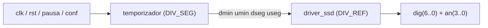

# Lab 4 — Digital clock

A 24-hour clock running on the Nexys 2: it counts from the board's 50 MHz oscillator and
shows the time on the four seven-segment displays. First sequential design of the course,
and the first one split into components.

| File | Role |
| --- | --- |
| [relogio.vhd](relogio.vhd) | Structural top level: wires the two components together |
| [temporizador.vhd](temporizador.vhd) | Counts hours, minutes and seconds, outputs four BCD digits |
| [driver_ssd.vhd](driver_ssd.vhd) | Multiplexes the four displays and decodes BCD to segments |
| [temporizador_simu.vhd](temporizador_simu.vhd) | Testbench for the counter alone |
| [relogio_simu.vhd](relogio_simu.vhd) | Testbench for the assembled clock |
| [pins.ucf](pins.ucf) | Pin assignments and the 20 ns clock period constraint |

## Design notes

**Two prescalers, one clock.** Nothing here has its own oscillator: both components
divide the same 50 MHz input. `DIV_SEG = 50000000` cycles make one second in the
counter; `DIV_REF = 50000` cycles keep each digit lit for 1 ms, so the four displays
are scanned at 250 Hz — fast enough that the eye sees them all lit at once.

**Generics instead of hardcoded constants.** Both divisors are generics, which is what
makes the design simulable at all: at 50 MHz a single displayed second would take
50 million clock edges. The testbenches instantiate the design with `DIV_SEG = 2`
and `DIV_REF = 1`, so a minute rollover shows up within a few microseconds of
simulated time, while synthesis keeps the real values.

**Counting in decimal digits.** The counter keeps six separate ranged integers
(`0 to 9` for units, `0 to 5` for tens of seconds and minutes, `0 to 2`
for tens of hours) rather than one seconds counter that is later converted. Each digit is
already a display digit, so no binary-to-BCD conversion is needed, and the ranges let the
synthesiser size every counter to the bits it actually needs.

**Control inputs.**

| Input | Effect |
| --- | --- |
| `rst` | Asynchronous: clears the whole count, takes precedence over the clock, over pausa and over conf |
| `pausa` | Freezes the count without clearing it — the prescaler stops too, so no partial second is lost |
| `conf` | Selects what the four digits show: minutes and seconds, or hours and minutes |

**Display multiplexing.** The four displays share the same cathode lines, so only one
digit can be driven at a time. The driver rotates the active anode and feeds the matching
BCD value to a decoder whose outputs are active low, the same encoding used in lab 2.

## Verification

Two testbenches, at different levels:

| Testbench | What it checks |
| --- | --- |
| `temporizador_simu` | Reset clears every digit; the count advances; pausa freezes it and releases it where it stopped; a minute rolls over after 59 s; conf swaps the displayed pair; reset still wins while pausa is active |
| `relogio_simu` | The assembled clock: the anode walks through the four displays and the segments follow the digit being driven |

Splitting them matters: in the top level the digits are multiplexed, so the waveform
shows one changing bus rather than four values. Probing the counter on its own is what
makes the BCD digits directly readable.

## Board mapping (Nexys 2)

| Signal | Pin |
| --- | --- |
| clk | 50 MHz oscillator (B8), constrained to a 20 ns period |
| rst, pausa, conf | SW0, SW1, SW2 |
| dig(6..0) | CA..CG (segments, active low) |
| an(3..0) | AN3..AN0 (anodes, active low; an(0) is the rightmost digit) |
